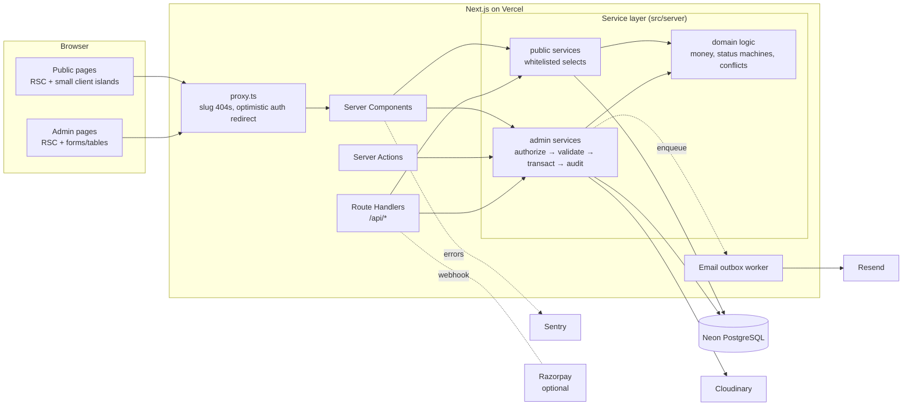
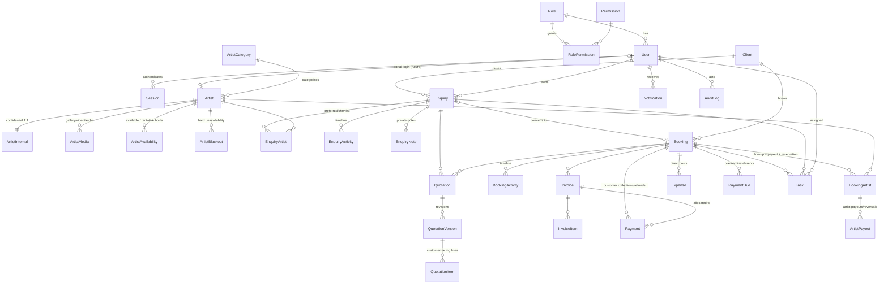

# BookMyArtist — Product & Technical Architecture

> Status: Phases 1–4 complete (architecture; public website; auth, RBAC, admin shell and enquiry CRM; artists, clients, tasks).
> Living document — update it whenever an architectural decision changes.
> Decisions and their rationale are recorded in [DECISIONS.md](./DECISIONS.md).

---

## 1. Product architecture

BookMyArtist is a single Next.js application with three logical areas that share one
PostgreSQL database and one service layer:

| Area | Audience | Auth | Design language |
| --- | --- | --- | --- |
| **Public website** (`/`, `/artists`, `/services`, …) | Customers, event planners | None | Dark, cinematic, editorial ("Stage") |
| **Admin dashboard** (`/admin/*`) | Agency staff | Session + RBAC | Light-first, neutral, data-dense ("Desk") |
| **Artist portal** (future, `/portal/*`) | Artists / partners | Session + `ARTIST` role | Reuses Desk |



### 1.1 Layering rules

1. **UI** (`src/app`, `src/components`) renders and collects input. It never imports Prisma.
2. **Server entry points** — Server Actions (`src/server/actions`) and Route Handlers (`src/app/api`) —
   parse input with Zod, resolve the session, and call one service function.
3. **Services** (`src/server/services`) own business operations. Every admin service function
   starts with `authorize(actor, permission)`, runs inside a transaction when it writes more than
   one row, and records an audit log entry for security/financial changes.
4. **Domain** (`src/server/domain`) is pure TypeScript: money arithmetic, status transition tables,
   conflict detection, reference formatting. No I/O → trivially unit-tested.
5. **Data access** is Prisma via a single client (`src/server/db.ts`). Public services use explicit
   `select` whitelists (`src/server/services/public/*`) so confidential columns can never leak by
   accident — the public selects physically cannot reach `ArtistInternal`.

### 1.2 Rendering & caching model

Next.js 16 with **Cache Components** enabled.

- Public catalogue pages (`/artists`, `/artists/[slug]`, `/services/[slug]`, home) read through
  `"use cache"` functions tagged `artists`, `artist:<slug>`, `categories`, `testimonials`.
  Admin mutations call `updateTag()` so edits appear immediately. `cacheLife('hours')` otherwise.
- Filtering on `/artists` uses `searchParams` → that part streams behind `<Suspense>` while the
  page chrome is in the static shell.
- Admin pages read the session (runtime data) and stream behind `loading.tsx` boundaries.
- Fully interactive widgets (booking wizard, filters, Kanban, calendar) are client islands.

---

## 2. Application folder structure

```text
encore/
├─ docs/                     Architecture, decisions, deployment, runbooks
├─ prisma/
│  ├─ schema.prisma          Relational schema (source of truth)
│  ├─ migrations/            SQL migrations (incl. hand-written constraints)
│  └─ seed/                  Idempotent seeders (roles, settings, demo catalogue)
├─ public/                   Static assets (textures, icons, OG fallback)
├─ src/
│  ├─ app/
│  │  ├─ (public)/           Public route group — Stage layout (header/footer)
│  │  │  ├─ page.tsx         Home
│  │  │  ├─ artists/         Directory + [slug] profiles
│  │  │  ├─ categories/      Category index
│  │  │  ├─ services/        Services index + [slug]
│  │  │  ├─ experiences/     Curated experiences
│  │  │  ├─ about/ contact/ book-an-artist/
│  │  ├─ admin/              Admin area — Desk layout
│  │  │  ├─ login/           Public login page (outside the protected group)
│  │  │  └─ (desk)/          Protected group: layout verifies session server-side
│  │  ├─ api/                Route handlers (enquiries, cron, webhooks, files)
│  │  ├─ sitemap.ts robots.ts manifest.ts opengraph-image.tsx
│  │  └─ layout.tsx          Root: fonts, <html>, global providers
│  ├─ components/
│  │  ├─ ui/                 shadcn/ui primitives (themed by CSS variables)
│  │  ├─ stage/              Public design-system components (hero, reveal, magnetic…)
│  │  ├─ desk/               Admin design-system components (stat card, data table…)
│  │  └─ shared/             Cross-area components (logo, money, date)
│  ├─ config/                site.ts (brand), navigation, feature flags
│  ├─ content/               Typed marketing copy (services, experiences, FAQ)
│  ├─ generated/prisma/      Generated Prisma client (git-ignored)
│  ├─ lib/                   Framework-agnostic helpers (money, time, labels, api envelope)
│  │  └─ validation/         Zod schemas shared by client & server
│  └─ server/
│     ├─ db.ts               Prisma client singleton (pg adapter)
│     ├─ env.ts              Zod-validated server environment
│     ├─ auth/               Sessions, password hashing, RBAC, current-user DAL
│     ├─ domain/             Pure business logic (money, transitions, conflicts…)
│     ├─ services/           Business operations (public/*, admin/*)
│     ├─ actions/            Server Actions (thin wrappers around services)
│     ├─ email/              Templates + outbox + Resend transport
│     └─ security/           Rate limiting, anti-bot, hashing, audit
├─ tests/
│  ├─ unit/                  Vitest: domain + validation
│  ├─ integration/           Vitest against encore_test database
│  └─ e2e/                   Playwright user journeys
├─ docker-compose.yml        Local Postgres 17 (dev + test databases)
└─ src/proxy.ts            real 404s for unknown slugs; optimistic admin login redirect
```

---

## 3. Database ER diagram

The full schema lives in [`prisma/schema.prisma`](../prisma/schema.prisma). Diagram grouped by domain
(columns trimmed to keys and the most important fields):



### 3.1 Major relationships explained

- **Artist ↔ ArtistInternal (1:1).** Public profile and confidential data (legal name, private
  contacts, base price, commission, notes) are separate tables. Public services never `include`
  or `select` `internal`, so private data cannot appear in public HTML or JSON.
- **Enquiry → Booking (0..1).** An enquiry is the customer's request; a booking is the commercial
  commitment. Conversion creates the booking in a transaction, links `Booking.enquiryId` (unique),
  moves the enquiry to `CONFIRMED`, and appends timeline entries on both. The enquiry is never
  deleted or overwritten, so history is preserved.
- **Enquiry snapshot vs Client.** Enquiries store the contact details *as submitted*. They are
  linked to a `Client` (auto-linked on an exact email/phone match, otherwise by staff with
  duplicate suggestions). Client edits never rewrite what the customer originally sent.
- **Booking ↔ BookingArtist ↔ Artist.** One booking can include many artists. Each
  `BookingArtist` row carries the performance window, buffers, the derived *blocked* window,
  the agreed artist payout, and a reservation status (`TENTATIVE` / `CONFIRMED` / `RELEASED`).
- **Quotation → QuotationVersion → QuotationItem.** The quotation is the stable document
  (number, status); each revision is an immutable version with its own items and totals.
  Quotation items contain customer prices only — payout and margin are not representable there.
- **Money flows.** `Payment` (customer → agency, incl. refunds), `ArtistPayout` (agency → artist,
  incl. reversals) and `Expense` (agency → vendor) are *transaction ledgers*. Agreed amounts live on
  `Booking.customerAmountPaise` and `BookingArtist.payoutPaise`. Every balance, margin and profit
  figure is **derived** from these rows (see §4.3) — never stored as a duplicated total.
- **PaymentDue** records planned instalments (advance/balance, receivable or payable) with due
  dates. Whether a due is paid is derived by comparing cumulative transactions against dues.

### 3.2 Schema conventions

| Concern | Convention |
| --- | --- |
| IDs | UUID (`gen_random_uuid` via Prisma `uuid()`), `@db.Uuid` |
| References | Human-readable, unique, per-year: `ENQ-2026-000123`, `BKG-…`, `QT-…`, `INV-…`, `RCP-…`, `PAY-…`, `EXP-…` from `DocumentSequence` (row-locked increment inside the creating transaction) |
| Time | `timestamptz(3)` in UTC; calendar dates (`eventDate`, `dueDate`) as `date`. UI renders in `Asia/Kolkata` |
| Money | `BigInt` paise, columns suffixed `Paise`; rates in basis points (`Bps`) |
| History | Archive (`archivedAt`), void (`voidedAt` + reason), cancel, supersede — no hard deletes of business records |
| Audit | `createdById` / `updatedById` on core entities, plus append-only `AuditLog` (before/after JSON) |
| Search | B-tree indexes on filter columns; trigram GIN on names for fuzzy search |

### 3.3 Database-level guarantees (hand-written SQL in the init migration)

- `EXCLUDE USING gist (artistId WITH =, tstzrange(blockedFrom, blockedUntil) WITH &&) WHERE reservationStatus = 'CONFIRMED'`
  — two confirmed reservations for the same artist can never overlap, even under concurrent requests.
- `CHECK` constraints: positive transaction amounts, non-negative agreed amounts, valid ranges, tax rate 0–100 %,
  singleton settings row.

---

## 4. Core business rules

### 4.1 Enquiry pipeline

`NEW → CONTACTED → QUALIFIED → QUOTATION_SENT → NEGOTIATION → CONFIRMED`, with `LOST` (requires a
reason) and `CANCELLED` reachable from any open state. Backwards moves are allowed one step for
corrections but are always recorded. Closed states (`CONFIRMED`, `LOST`, `CANCELLED`) can be
re-opened only by `MANAGER+`. `CONFIRMED` is set only by conversion to a booking.
The transition table lives in `src/server/domain/enquiry-status.ts` and is shared by the table view and Kanban.

### 4.2 Booking lifecycle & confirmation gate

`ENQUIRY → QUOTATION → NEGOTIATION → CONFIRMED → ADVANCE_RECEIVED → ARTIST_CONFIRMED → UPCOMING → COMPLETED`,
plus `CANCELLED` and `REFUNDED`. Moving to `CONFIRMED` requires: a client, event date + start/end
time, venue/city, a customer amount, at least one artist with a payout and a performance window,
and no hard conflicts. Moving to `ARTIST_CONFIRMED` flips every `BookingArtist` to `CONFIRMED`
reservation status (guarded by the exclusion constraint).

### 4.3 Financial model (per booking, all integers in paise)

```
customerAgreed      = Booking.customerAmountPaise                    (pre-tax)
customerReceived    = Σ Payment(PAYMENT, COMPLETED) − Σ Payment(REFUND, COMPLETED)
customerOutstanding = customerAgreed + invoicedTax − customerReceived
artistAgreed        = Σ BookingArtist.payoutPaise (not RELEASED)
artistPaid          = Σ ArtistPayout(PAYOUT) − Σ ArtistPayout(REVERSAL)
artistOutstanding   = artistAgreed − artistPaid
expenses            = Σ Expense(bookingId, COMPLETED)  (split: travel/logistics vs other)
grossMargin         = customerAgreed − artistAgreed        ← "agency commission"
netProfit           = grossMargin − expenses               ← before overheads
```

Example from the brief: customer ₹1,00,000, artist ₹70,000, expenses ₹5,000 →
gross margin ₹30,000, net profit ₹25,000. Tax collected on invoices is a pass-through and never
counted as revenue or margin. GST is *configurable*, not claimed compliant (see DECISIONS ADR-009).

### 4.4 Availability & conflicts

- Blocked window = performance window − (setup + travel) … + (teardown + travel). Defaults come
  from `BusinessSettings`, overridable per booking artist.
- Hard conflicts: overlapping `CONFIRMED` reservation or active `ArtistBlackout` → reject.
- Soft conflicts: overlapping `TENTATIVE` reservation or `TENTATIVE_HOLD` → warn, allow.
- Server re-checks inside a transaction and the exclusion constraint is the final guard.

---

## 5. API contracts

Most admin mutations are **Server Actions** (CSRF-protected by Next.js origin checks, typed end-to-end).
Route Handlers exist where an HTTP contract is needed (public form submission from any page, webhooks,
cron, file downloads, CSV export). All responses use:

```ts
type ApiResult<T> =
  | { ok: true; data: T }
  | { ok: false; error: { code: string; message: string; fieldErrors?: Record<string, string[]> } };
```

| Method & path | Auth | Purpose |
| --- | --- | --- |
| `POST /api/enquiries` | Public, rate-limited, anti-bot | Create enquiry → `{ reference }` only |
| `GET /api/artists/search?q=` | Public | Lightweight artist typeahead (public fields only) |
| `GET /api/files/:id` | Session + permission | Short-lived redirect to a private file |
| `GET /api/admin/reports/:report.csv` | Session + `report:read` | CSV export |
| `GET /api/admin/quotations/:id/pdf` | Session + `quotation:read` | Quotation PDF |
| `GET /api/admin/invoices/:id/pdf` | Session + `finance:read` | Invoice PDF |
| `POST /api/webhooks/razorpay` | HMAC signature | Payment capture (optional) |
| `GET /api/cron/outbox` | `CRON_SECRET` bearer | Deliver/retry queued emails |
| `GET /api/cron/reminders` | `CRON_SECRET` bearer | Follow-up / due / event reminders |

Server Action naming: `src/server/actions/<module>.ts` → `createArtistAction`, `changeEnquiryStatusAction`, …
Each returns `ApiResult<T>`.

### 5.1 Permissions (RBAC)

Permission keys are `<resource>:<verb>`. Roles are data (seeded), so new roles need no code change.

| Permission | SUPER_ADMIN | ADMIN | MANAGER | STAFF | FINANCE |
| --- | :-: | :-: | :-: | :-: | :-: |
| `enquiry:read` / `enquiry:write` | ✓ | ✓ | ✓ | ✓ | read |
| `artist:read` / `artist:write` | ✓ | ✓ | ✓ | read | read |
| `artist:internal` (rates, contacts) | ✓ | ✓ | ✓ | – | ✓ |
| `artist:delete` (no-history artists only) | ✓ | ✓ | – | – | – |
| `enquiry:delete` (no quotations, booking or files) | ✓ | ✓ | – | – | – |
| `client:read` / `client:write` | ✓ | ✓ | ✓ | ✓ | read |
| `booking:read` / `booking:write` | ✓ | ✓ | ✓ | ✓ | read |
| `quotation:read` / `quotation:write` | ✓ | ✓ | ✓ | ✓ | read |
| `finance:read` / `finance:write` | ✓ | ✓ | read | – | ✓ |
| `report:read` | ✓ | ✓ | ✓ | – | ✓ |
| `task:read` / `task:write` | ✓ | ✓ | ✓ | ✓ | ✓ |
| `settings:write` | ✓ | ✓ | – | – | – |
| `user:manage` | ✓ | ✓ | – | – | – |

---

## 6. Main user journeys

1. **Visitor → enquiry.** Lands on home (hero → featured artists) → browses `/artists`, filters by
   category/city/event → opens a profile (gallery, video, audio, approved price) → "Enquire" opens
   `/book-an-artist?artist=<slug>` with the artist pre-selected → 4-step wizard → review → submit →
   reference number on screen + confirmation email.
2. **Service-led visitor.** Lands on `/services/weddings` from search → sees suggested artists for
   weddings → enquires with `service=WEDDING` preserved.
3. **Staff triage.** New-enquiry email + in-app notification → `/admin/enquiries` (overdue follow-ups
   pinned on top) → opens enquiry → links/creates client → assigns owner and priority → logs a call →
   sets follow-up → shortlists artists → moves to `QUALIFIED`.
4. **Quote → book.** Creates quotation from enquiry (artist lines, discount, tax, terms) → previews
   PDF → emails → revises (v2) → marks accepted → converts to booking (customer amount, artist payouts,
   performance window) → conflict check → `CONFIRMED`.
5. **Money.** Records customer advance (receipt PDF) → `ADVANCE_RECEIVED` → records artist advance →
   artist confirms → `ARTIST_CONFIRMED` → expenses logged → event day → balance collected → artist
   balance paid → `COMPLETED`. Finance overview shows margin and net profit per booking.
6. **Owner review.** Dashboard KPIs for a date range, revenue/collection charts, conversion funnel,
   lost-reason analysis, CSV exports.

---

## 7. UI design direction

### 7.1 Public — "Stage"

- **Mood:** a concert hall after the lights go down. Deep midnight (`#07060F`) ground, light comes
  from the content: photography and electric violet/magenta glows, like stage wash lights.
- **Palette:** midnight 950 `#07060F`, 900 `#0D0B1C`, 800 `#16132B`; electric purple `#7C3AED`;
  violet `#A78BFA`; magenta `#E935C1`; signal blue `#4F7BFF`; text white `#F6F4FF`, muted `#A8A3C2`.
- **Type:** **Unbounded** (wide geometric grotesk) for display headlines and uppercase micro-labels
  with wide tracking, paired with **Inter** for reading text. Very large headline scale (clamp up
  to ~9rem), tight leading.
- **Composition:** asymmetric editorial grids, oversized numerals, overlapping image + text layers,
  marquee bands, a horizontal scroll strip for featured artists, an equaliser motif.
- **Motion:** Motion (Framer Motion) for reveals, hover and magnetic CTAs; GSAP + ScrollTrigger only
  for the scroll-scrubbed hero parallax and the horizontal "featured artists" pin. All motion
  disabled/softened under `prefers-reduced-motion`.

### 7.2 Admin — "Desk"

- Light-first neutral shadcn theme, optional dark mode, one accent (violet 600) tying it to the brand.
- Dense but calm tables, sticky headers, keyboard-first command palette (⌘K), status colour pairs
  that also carry icons/text (never colour alone).

---

## 8. Implementation roadmap

| Phase | Scope | Status |
| --- | --- | --- |
| 1 | Architecture, schema, ER diagram, contracts, standards | ✅ Done |
| 2 | Design system, public website (home, artists, profiles, categories, services, experiences, about, contact) and the working enquiry pipeline (wizard → validation → anti-bot → rate limit → DB → outbox → notifications). DB + Prisma brought forward from Phase 3 so the public site reads real data. | ✅ Done — see §9 |
| 3 | Auth (sessions, Argon2id, RBAC), roles/permissions seed, initial admin bootstrap. Admin shell, dashboard and the enquiry CRM (table + board) brought forward from Phase 4. | ✅ Done — see §10 |
| 4 | Artists CRUD (with catalogue cache invalidation), clients, tasks, more dashboard metrics | ✅ Done — see §11 |
| 5 | Bookings, calendar & conflicts, quotations (versions), invoices, payments, payouts, expenses, finance | Next |
| 6 | Resend outbox delivery, Cloudinary uploads, PDFs, Razorpay (optional), Sentry | |
| 7 | Integration + Playwright e2e suites, security review, performance & a11y passes | |
| 8 | GitHub CI, Vercel + Neon environments, domain, production verification | |

## 9. Phase 2 notes

See README "Current status" for the exact list of what is implemented and verified.

- **Rendering.** Home, categories, services, experiences and about are fully static
  (prerendered from cached catalogue reads). Artist and service detail pages are prerendered
  for every known slug; `/artists` filters, the booking wizard and the contact form stream
  behind Suspense because they read `searchParams` or issue a per-request form token.
- **Unknown slugs.** With Cache Components the static shell starts a 200 response before
  request-time checks run, so `src/proxy.ts` returns real 404s: service slugs from the static
  list, artist slugs from a per-instance set refreshed every 60 s (ADR-015).
- **Enquiry API.** `POST /api/enquiries` → `{ ok: true, data: { reference } }` (201) or
  `{ ok: false, error: { code, message, fieldErrors? } }` with 403 (cross-origin), 413, 415,
  422 (validation / honeypot / token / captcha), 429 (rate limit, with `Retry-After`) or 500.
- **Motion budget.** GSAP is loaded dynamically, only for the hero parallax and the pinned
  featured-artists rail (desktop only). All other motion uses Motion. Everything is disabled
  under `prefers-reduced-motion`.

## 10. Phase 3 notes

See README "Current status" for the verified feature list; decisions in ADR-017 to ADR-020.

- **Request flow for an admin mutation.** Client component → Server Action
  (`src/server/actions/*`, POST-only, Next.js origin check) → `requireActor()` re-reads and
  validates the session → `parseInput()` with the shared Zod schema → one service function →
  `authorize()` → transaction (+ timeline/audit) → `refresh()` so the page re-renders →
  `ApiResult` back to the client. `runAction()` maps `ServiceError`/`AuthorizationError` to
  `{ ok: false }` and logs unexpected errors by name only.
- **Auth modules.** `auth/password.ts` (Argon2id), `auth/session.ts` (create/validate/revoke,
  sliding idle expiry, absolute limit), `auth/cookie.ts` (cookie name/attributes, no
  `server-only` so proxy can read the name), `auth/dal.ts` (`getActor`, `requireActor`,
  `actorWith`), `auth/actor.ts` (`can`, `authorize`). `services/auth.ts` covers sign-in, sign-out,
  password change and own sessions; `services/admin/users.ts` covers team management.
- **Concurrency.** Status changes are conditional updates on the status the user saw
  (`WHERE id = ? AND status = from`), so two people acting at once can't silently overwrite each
  other; the loser gets a "refresh" message. The automatic NEW → CONTACTED move is conditional too.
- **Time.** Follow-ups are entered as IST wall-clock times and stored in UTC
  (`businessLocalToUtc`). "Due" means at or before the end of today in IST.
- **Schema change.** Migration `20261123140000_user_password_flags` adds
  `User.mustChangePassword` and `User.passwordChangedAt`.
- **Housekeeping.** The 15-minute cron also deletes sessions that expired or were revoked more
  than 30 days ago.
- **Known limits.** No password-reset email yet (admins reset). The board is a view: cards open
  the enquiry, where status changes are made with full validation (no drag-and-drop). Enquiries
  can't yet be created or edited by staff (Phase 4, with clients).

## 11. Phase 4 notes

See README "Current status" for the verified feature list; decisions in ADR-022 to ADR-024.

- **Catalogue invalidation.** Artist services return the slugs they touched (old *and* new on a
  rename). `src/server/actions/artists.ts` then calls `updateTag` for `artists`, `categories`,
  `testimonials` and each `artist:<slug>`, and resets this instance's active-slug set used by
  `proxy.ts`. Services can't call `updateTag` (Server Actions only), which keeps them testable.
- **Confidential split.** `getArtistForAdmin` only adds `internal` to the Prisma `select` when the
  actor holds `artist:internal`, so the data never leaves the database otherwise. Writing it needs
  `artist:write` + `artist:internal`. Audit entries hold before/after money fields and the names of
  changed text fields — never the notes, contacts or payout reference themselves.
- **Concurrency.** Artist and client edits carry `expectedUpdatedAt`; the update is conditional on
  it, so a stale tab gets a "reload" message instead of overwriting. Status changes (artists,
  tasks) are conditional on the status the user saw, like enquiries.
- **Forms.** Money is typed in rupees and converted to paise strings by shared Zod helpers
  (`src/lib/validation/common.ts`); percentages become basis points. Neither passes through a JS
  float. Image links must be https on a host `next/image` and the CSP allow.
- **Tasks.** Status rules and IST due buckets are pure (`src/server/domain/task.ts`). "Overdue" is
  before now; "today" runs to the end of the IST day; finished tasks are never overdue.
- **Known limits.** No category, gallery/media or testimonial management yet; images are pasted
  links until Cloudinary uploads (Phase 6). Task reminders are in-app notifications on assignment
  only; due-date reminder emails come with the reminders cron (Phase 6). Staff can't create
  enquiries by hand yet.

